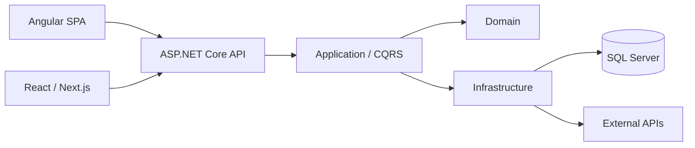
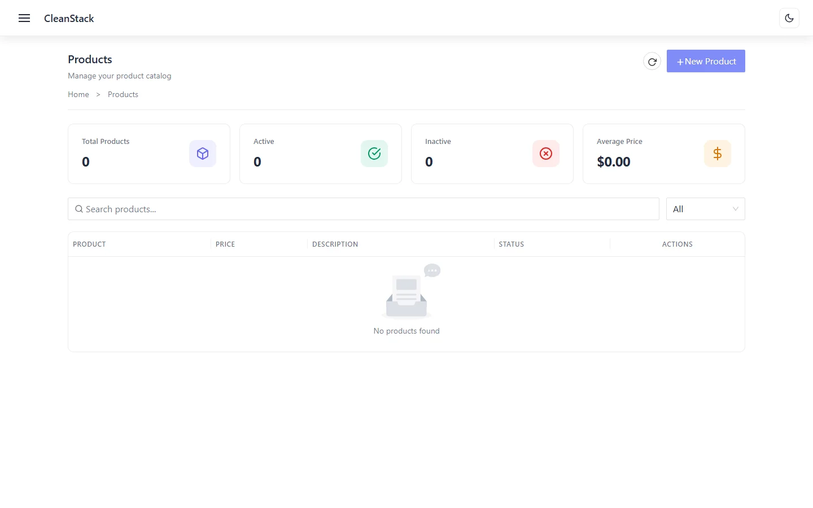
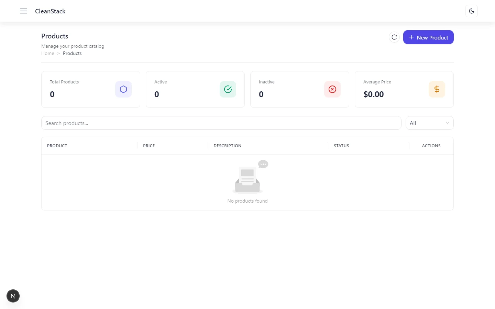
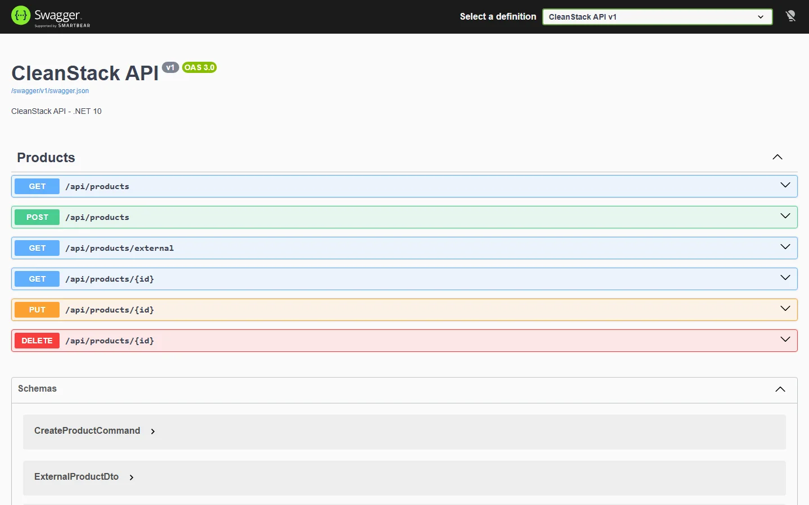

# CleanStack

A full stack starter for building maintainable applications with a .NET backend and an Angular or React/Next.js frontend.

Use the .NET backend with either Angular or React/Next.js. The frontends are independent and should not be mixed within the same product.

[](https://github.com/luismpenholato/clean-stack/actions/workflows/backend-ci.yml)
[](https://github.com/luismpenholato/clean-stack/actions/workflows/angular-ci.yml)
[](https://github.com/luismpenholato/clean-stack/actions/workflows/react-ci.yml)


[](LICENSE)
[](https://github.com/sponsors/luismpenholato)

[Quick start](#quick-start) · [Screenshots](#screenshots) · [Architecture](#architecture) · [Validation](#validation-commands) · [Roadmap](#roadmap)

## Project scope

CleanStack provides product management examples, layered backend code, independent frontends and CI workflows. It is a starting point to adapt, not a finished SaaS product.

**Before deploying:** real backend authentication and React route protection are still on the [roadmap](#roadmap). Development uses an in-memory database, which does not retain data across restarts. Review authorization, persistence and deployment settings for your own product.

## Key features

- **Clean Architecture** backend with layered projects and clear boundaries
- **CQRS** with MediatR (Commands and Queries per feature)
- **FluentValidation** in handlers (`ValidateAndThrowAsync`)
- **EF Core** and **FluentMigrator** (InMemory for dev, SQL Server for production-style setups)
- Structured logging with **Serilog**
- External API integration with **Refit**
- **Angular** enterprise SPA option (ng-zorro, signals, Vitest)
- **React / Next.js** SaaS and SSR option (Ant Design, TanStack Query, App Router)
- Automated tests across backend and both frontends
- **Docker** support per application
- **Independent frontends** — choose one stack per product

## Choosing a frontend

| Scenario                                        | Recommendation                                                                           |
| ----------------------------------------------- | ---------------------------------------------------------------------------------------- |
| Enterprise admin, traditional SPA, Angular team | [`frontend-angular/`](frontend-angular/) — Angular 21 + ng-zorro                         |
| New SaaS, SSR, SEO, App Router, React ecosystem | [`frontend-react/`](frontend-react/) — React 19 + Next.js 16 + Ant Design                |
| Same backend, different products                | Use **one frontend per product** — do not mix Angular and React patterns in the same app |

Both frontends consume the same REST API and share UI route conventions (`/products`, `/products/new`, `/products/:id/edit`), but they are separate codebases. Pick the stack that fits your team and product; you normally choose **one** frontend when starting a new product.

## Architecture



In development, the API can use an **InMemory** database instead of SQL Server (see [Configuration](#configuration)).

### Backend request flow

```txt
Controller → MediatR → Handler → Repository/Service → Database or external API
```

| Layer              | Responsibility                                       |
| ------------------ | ---------------------------------------------------- |
| **Domain**         | Entities, repository and service interfaces          |
| **Application**    | Commands/Queries, handlers, validators (`Features/`) |
| **Infrastructure** | EF Core, repositories, HTTP integrations             |
| **Interface**      | Controllers, `Program`, middlewares, Swagger         |
| **CrossCutting**   | DTOs, options, helpers                               |
| **Migration**      | FluentMigrator (SQL schema)                          |
| **Tests**          | Mirror `Application/Features/`                       |

Details: [`backend-dotnet/README.md`](backend-dotnet/README.md).

## Screenshots

### Angular

[](docs/images/angular-products.webp)

### React / Next.js

[](docs/images/react-products.webp)

### Backend API

[](docs/images/swagger.webp)

## Quick start

### Prerequisites

| Tool                                                          | Minimum version          | Notes                                                                |
| ------------------------------------------------------------- | ------------------------ | -------------------------------------------------------------------- |
| [.NET SDK](https://dotnet.microsoft.com/download/dotnet/10.0) | **10.0.301+**            | Pinned in [`backend-dotnet/global.json`](backend-dotnet/global.json) |
| [Node.js](https://nodejs.org/)                                | **24+**                  | See `.nvmrc` in each frontend folder                                 |
| npm                                                           | Included with Node.js 24 | Use `npm ci` with the committed lockfiles                            |
| Docker                                                        | optional                 | Per-application Dockerfiles                                          |

Clone the repository first:

```bash
git clone https://github.com/luismpenholato/clean-stack.git
cd clean-stack
```

Run each application below in a **separate terminal, starting at the repository root**.

### Backend

```bash
cd backend-dotnet
dotnet restore backend-dotnet.sln
dotnet run --project CleanStack.Interface
```

- Swagger: https://localhost:5001/swagger
- HTTP API: http://localhost:5000

### Frontend Angular

```bash
cd frontend-angular
npm ci
npm start
```

App: http://localhost:3000

### Frontend React (Next.js)

Create `frontend-react/.env.local` using the values in [Frontend React configuration](#frontend-react) before starting or building the app. Preserve any settings already present in that file.

```bash
cd frontend-react
npm ci
npm run dev
```

App: http://localhost:3000 — use another port if Angular is already running (`npm run dev -- -p 3001`).

> Run the backend in parallel. Both frontends target `http://localhost:5000` for the API in development.

## Use as a template

CleanStack can be used as a GitHub repository template.

1. Click **Use this template** on GitHub.
2. Create a new repository from the template.
3. Choose either `frontend-angular` or `frontend-react` for your product.
4. Remove the unused frontend if it will not be maintained.
5. Update application names, environment variables and connection settings.
6. Review the [roadmap](#roadmap) before using the foundation in production.

## Repository structure

```txt
clean-stack/
  backend-dotnet/     → .NET 10 API (Clean Architecture + CQRS)
  frontend-angular/   → Angular 21 SPA (ng-zorro)
  frontend-react/     → React 19 + Next.js 16 (Ant Design)
  docs/images/        → screenshots
  .github/            → CI workflows, issue/PR templates
  README.md
  CONTRIBUTING.md
  SECURITY.md
  CODE_OF_CONDUCT.md
  CHANGELOG.md
  LICENSE
```

| Project                                  | Stack highlights                                                                 |
| ---------------------------------------- | -------------------------------------------------------------------------------- |
| [`backend-dotnet/`](backend-dotnet/)     | ASP.NET Core, EF Core, MediatR, FluentValidation, FluentMigrator, Refit, Serilog |
| [`frontend-angular/`](frontend-angular/) | ng-zorro-antd, RxJS, Vitest                                                      |
| [`frontend-react/`](frontend-react/)     | Ant Design, TanStack Query, Axios, React Hook Form, Zod, Vitest                  |

## Validation commands

Run these from the **repository root** before opening a pull request for the affected area. The commands use explicit paths so they can be run in sequence without changing directories.

```bash
# Backend
dotnet restore backend-dotnet/backend-dotnet.sln
dotnet build backend-dotnet/backend-dotnet.sln --configuration Release
dotnet test backend-dotnet/backend-dotnet.sln --configuration Release

# Angular
npm ci --prefix frontend-angular
npm run build --prefix frontend-angular
npm test --prefix frontend-angular -- --watch=false

# React
npm ci --prefix frontend-react
npm run lint --prefix frontend-react
npm run test --prefix frontend-react
npm run build --prefix frontend-react
```

## Configuration

### Backend

| Variable / key                | Description                             |
| ----------------------------- | --------------------------------------- |
| `ConnectionStrings__Default`  | SQL Server connection string            |
| `Database:Provider`           | `InMemory` (dev default) or `SqlServer` |
| `ExternalProductApi__BaseUrl` | External API URL (e.g. FakeStore)       |

See [`backend-dotnet/README.md`](backend-dotnet/README.md).

### Frontend Angular

| File                                          | Key                                    |
| --------------------------------------------- | -------------------------------------- |
| `src/environments/environment.development.ts` | `apiBaseUrl` (`http://localhost:5000`) |

### Frontend React

The current checkout does not include a `frontend-react/.env.example`. Create `frontend-react/.env.local` with these local values:

```dotenv
NEXT_PUBLIC_API_BASE_URL=http://localhost:5000
NEXT_PUBLIC_APP_NAME=CleanStack
NEXT_PUBLIC_SITE_URL=http://localhost:3000
```

These `NEXT_PUBLIC_*` values are public client configuration, not a place for secrets. Set them before building and rebuild when changing the deployed API URL.

| Variable                   | Description                                     |
| -------------------------- | ----------------------------------------------- |
| `NEXT_PUBLIC_API_BASE_URL` | API base URL (e.g. `http://localhost:5000`)     |
| `NEXT_PUBLIC_APP_NAME`     | App display name and SEO tags                   |
| `NEXT_PUBLIC_SITE_URL`     | Public site URL (metadata, sitemap, Open Graph) |

## Docker

Build images from each project directory:

| Service   | Dockerfile                                                                                         |
| --------- | -------------------------------------------------------------------------------------------------- |
| API       | [`backend-dotnet/CleanStack.Interface/Dockerfile`](backend-dotnet/CleanStack.Interface/Dockerfile) |
| Migration | [`backend-dotnet/CleanStack.Migration/Dockerfile`](backend-dotnet/CleanStack.Migration/Dockerfile) |
| Angular   | [`frontend-angular/Dockerfile`](frontend-angular/Dockerfile)                                       |
| React     | [`frontend-react/Dockerfile`](frontend-react/Dockerfile)                                           |

```bash
# API (from backend-dotnet/)
docker build -t cleanstack-api:latest -f CleanStack.Interface/Dockerfile .

# Angular (from frontend-angular/)
docker build -t cleanstack-angular:latest .

# React (from frontend-react/)
docker build -t cleanstack-react:latest .
```

A root `docker-compose.yml` is planned once SQL Server, migrations and services can start together without code changes (see [Roadmap](#roadmap)).

## Roadmap

### Security

- [ ] Real JWT authentication in the backend (`/api/auth/login`)
- [ ] Route guard / middleware in `frontend-react`

### Architecture

- [ ] Align API contracts between Angular and React (`Product.Id` long vs string)
- [ ] Decouple Domain from CrossCutting / Refit (dependency inversion)

### Frontend

- [ ] Global `401` interceptor in React when real auth exists

### Developer Experience

- [x] Document minimum Node version in per-frontend `.nvmrc` files
- [ ] Root `docker-compose.yml` with SQL Server, migrations and profile-based frontends

### Deployment

- [ ] Migration Docker: copy `appsettings.json` in Release and support environment variables

## Skills for AI agents

Complementary skills in [`maurao-skills`](https://github.com/luismpenholato/maurao-skills):

```bash
npx skills add luismpenholato/maurao-skills --skill dotnet-backend-clean-architecture
npx skills add luismpenholato/maurao-skills --skill angular-frontend-clean-architecture
npx skills add luismpenholato/maurao-skills --skill react-nextjs-antd-clean-architecture
```

## Contributing

See [CONTRIBUTING.md](CONTRIBUTING.md) for setup, conventions, and the pull request workflow.

For structural changes, open an [architecture discussion](.github/ISSUE_TEMPLATE/architecture-discussion.yml) before large refactors.

## Security

Report vulnerabilities privately — **do not** open public issues. See [SECURITY.md](SECURITY.md).

## Support

- [Issues](https://github.com/luismpenholato/clean-stack/issues) for bugs and feature requests
- [GitHub Sponsors](https://github.com/sponsors/luismpenholato) to support ongoing maintenance

## License

This project is licensed under the [MIT License](LICENSE).

## Community

See the [Code of Conduct](CODE_OF_CONDUCT.md) for community standards and the [Changelog](CHANGELOG.md) for notable changes.
